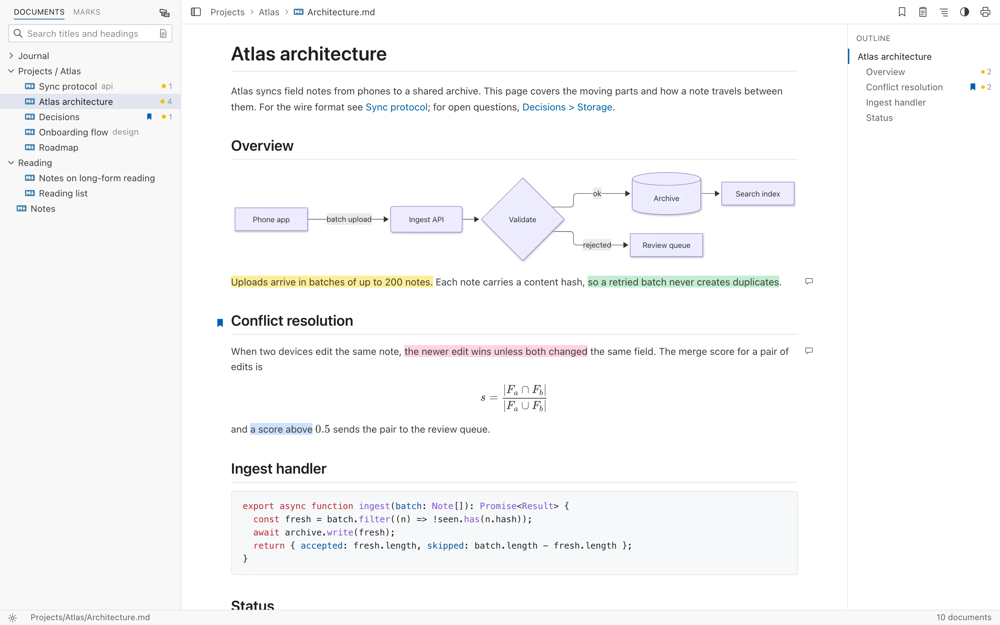

<p align="center">
  
</p>

<h1 align="center">Folio</h1>

<p align="center">
  Read, search and review folders of Markdown — specs, ADRs, notes and Obsidian vaults.<br>
  For macOS, Windows and Linux, or self-hosted in the browser.
</p>

<p align="center">
  <a href="https://github.com/crazzybot/markdown-viewer/releases/latest"></a>
  <a href="https://github.com/crazzybot/markdown-viewer/actions/workflows/ci.yml"></a>
  <a href="LICENSE"></a>
</p>

<p align="center">
  
</p>

Open a folder and Folio lists every Markdown file in it, lets you search titles,
headings and full text, and renders documents with syntax highlighting, math,
Mermaid diagrams and Obsidian-style links. Highlight passages, write notes on
them and bookmark sections as you read, then find every mark again in one list.
It never edits your files: marks are kept in Folio's own folder.

Folio is made for the documents you have to read closely, such as the specs,
architecture decision records and design proposals that pile up in every
project, more and more of them written by coding agents. Open a project's docs
folder, focus on the part you're reviewing, and mark what needs another pass.

## Download

Get the latest version from the [download page](https://crazzybot.github.io/markdown-viewer/download.html)
or from [GitHub Releases](https://github.com/crazzybot/markdown-viewer/releases/latest):

| Platform | File |
|---|---|
| macOS (Apple Silicon) | `Folio-<version>-arm64.dmg` — signed and notarized |
| macOS (Intel) | `Folio-<version>.dmg` — signed and notarized |
| Windows | `Folio.Setup.<version>.exe` — not code-signed yet, so SmartScreen shows a warning: choose **More info → Run anyway** |
| Linux | `Folio-<version>.AppImage` — `chmod +x` it, then run it |

The app checks for updates at launch (**Folio → Check for Updates…**).

## Features

- Recursive workspace scan — supports sub-folders
- Documents grouped by folder (toggle in the sidebar header, remembered): only folders that hold documents, folder-only chains merged ("api / v2"), single-document folders replaced by their document; the open document's folders expand. Full keyboard navigation: ↑ ↓ Home End, → ← to expand / collapse, Enter to open, ↓ from the search box into the list
- Focus on a folder: the focus button on a folder row (it appears on hover), a folder in the breadcrumb, or right-click a folder in the desktop app. The list, search and document count narrow to that folder; links and images still resolve across the whole workspace. Clear it with ✕ on the folder bar or Escape in the list; it's remembered per workspace. The desktop app's folder menu also has **Open Folder as Workspace**
- Highlights and notes: select text and pick one of four colours from the toolbar above it (or `⇧⌘H` / `Ctrl+Shift+H` for the last colour), or **Add note** to highlight it and write a note. Click a highlight to change its colour, write or edit its note, or remove it; highlights with a note show an icon in the margin. Documents with highlights show a count in the list, and the outline shows how many each section has
- Bookmarks: bookmark the document with the header's bookmark button (`⌘D` / `Ctrl+D`), or a section with the button that appears beside a heading on hover
- Marks view (the sidebar's **Marks** tab): the marks of every document in the workspace (or the focused folder), grouped by document — its bookmarked sections by heading, then its highlights and notes — with a filter and a **Notes only** switch. A ★ on a document's row means the document itself is bookmarked. Click one to go to it; Back returns. Highlights whose text was since deleted from the document are shown as not found, and can be removed there. The open document's bookmarked sections show a bookmark icon in its outline
- Marks are kept in `~/.folio` (`%USERPROFILE%\.folio` on Windows), never in your files, and follow the text when the document is edited. The same file has the same marks whichever folder you open
- Moved and deleted documents: marks follow a file moved or renamed without edits by themselves. Otherwise its marks are listed under **Missing documents** in the Marks view, with a suggested document when one with the same name holds most of them, **Move to…** any document, or **Delete** (after asking). Nothing is deleted on its own
- Instant search across titles, filenames and headings — a matching heading opens the document at that section
- Outline of the open document's headings beside it (header toggle, remembered): the section being read is highlighted as you scroll, and clicking a heading jumps there (Back returns). Hidden in narrow windows
- Find in the open document (`⌘F` / `Ctrl+F`): matches highlighted with a "3 of 12" count; Enter / Shift+Enter, `⌘G` / `⇧⌘G` or F3 / Shift+F3 step through them, Escape closes
- Full-text search on demand (the page icon in the search box, `⇧⌘F` / `Ctrl+Shift+F`, remembered): matching lines appear under each document, and opening one highlights every match in the viewer and scrolls to it
- Resizable / collapsible sidebar (mouse drag, keyboard arrows, `⌘B`)
- VS Code-style light and dark themes with breadcrumb header and status bar
- Display options menu in the header (◐): appearance (System, Light, Dark), document style (Default; Book — serif, airy; Compact — dense), reading width (Narrow, Medium, Wide, Full) and font size (Small, Medium, Large, Extra large). Styles apply to print and PDF too
- Settings panel (`⌘,` / `Ctrl+,`, or the gear in the status bar) for everything above; in the desktop app also the workspace folder, skipped folders, scan depth and editor, kept in sync with `settings.json`
- Custom CSS (desktop): **View → Edit Custom CSS…** opens `custom.css` (created from a commented template), applied on top of the chosen style and reloaded as you save; target the document with `.folio-document`
- GFM support: tables, task lists, strikethrough
- Obsidian vaults: `[[Note]]`, `[[Note|alias]]`, `[[Note#Heading]]`, `[[#Heading]]` links (resolved by file name anywhere in the workspace, nearest first) and `![[image.png|300]]` image embeds; YAML front matter is hidden, and its `title:` names the document
- Math with KaTeX: `$E=mc^2$` inline (GitHub's rules, so prices like "$5 and $10" stay text), `$$…$$` and ```` ```math ```` blocks
- Mermaid diagrams from ```` ```mermaid ```` blocks, drawn in the current light / dark theme (Mermaid loads only when a document has one). A diagram that sets its own colours (`rect rgb(…)`, `fill:`) or theme (`%%{init: {"theme": …}}%%`) is drawn for the background it was written for, on a card of that background, so its text stays readable in either theme. Hover a diagram and click its expand button (or double-click it) to open it in the whole window, under a title bar with its caption (the diagram's `title`, or the nearest heading) that still drags the window: zoom with the toolbar, ⌘ / Ctrl + scroll, a trackpad pinch or `+` / `-`; pan by dragging, scrolling or with the arrow keys; `0` fits and recentres, `1` shows actual size, Escape closes
- Images from the workspace (``, relative to the document) and the web
- Copy button on code blocks (on hover or keyboard focus)
- Links to other files (`[data](report.pdf)`) open in their app on the desktop, or in a new tab in the browser — documents, data, office files, images and media only; links to scripts, executables, HTML and the like are shown as unavailable
- Syntax-highlighted fenced code blocks (Python, JS/TS, JSON, Bash, CSS, HTML, YAML, Markdown)

---

## Building from source

You only need this to work on Folio or to run the browser version; to just use
the app, [download it](#download). Contributions are welcome: see
[CONTRIBUTING.md](CONTRIBUTING.md).

### Prerequisites

| Tool | Minimum version |
|------|----------------|
| Node.js | 20.19 (CI uses 24) |
| npm | 10 |
| Python (browser version only) | 3.13 |
| [uv](https://docs.astral.sh/uv/) (browser version only) | latest |

### Quick start (browser version)

```bash
git clone https://github.com/crazzybot/markdown-viewer.git
cd markdown-viewer
cp .env.example .env   # edit as needed
```

**Terminal 1 — Backend**

```bash
cd backend
MARKDOWN_WORKSPACE=../workspace uv run uvicorn app.main:app --reload --port 8000
```

**Terminal 2 — Frontend dev server**

```bash
cd frontend
npm install
npm run dev
```

Open [http://localhost:3000](http://localhost:3000) in your browser.

> **Tip:** The `workspace/` folder already contains two sample documents
> (`welcome.md` and `samples/code-demo.md`) so the app is usable immediately.

**Or with Docker** — `docker compose up --build` serves the app at
[http://127.0.0.1:3000](http://127.0.0.1:3000), browsing `./workspace`
read-only (set `WORKSPACE_DIR` in `.env` to browse another folder).

---

## Desktop app (Electron)

The `desktop/` package wraps the same React frontend in an Electron app. The
FastAPI backend isn't needed there: the workspace scanner is ported to Node
(`desktop/src/scanner.ts`, same IDs and titles) and runs in the main process,
reached from the UI over IPC.

```bash
cd desktop
npm install

npm start            # build frontend + main process, launch the app
npm run dist:mac     # package → release/*.dmg and *.zip (also dist:win, dist:linux)
```

On first launch the app asks for a folder of Markdown files; the choice is
remembered. Change it with **File → Open Folder…** (`⌘O`).

The folder is watched while the app is open: saving a document in your editor
updates it in place (keeping your scroll position), and added, renamed or
deleted files show up in the document list right away. Folders in `skipDirs`
are ignored.

**Opening files and folders from the system** — a Markdown file opens in
place when it belongs to the current workspace (so Back returns to where you
were); otherwise its folder becomes the workspace. A folder becomes the
workspace. Any of these work:

- **Finder / Explorer** — Folio registers for `.md` and `.markdown` (and, on
  macOS, folders) as an alternative app: use **Open With → Folio**, or make it
  the default for Markdown files.
- **Drag and drop** a file or folder onto the window (or the Dock icon).
- **Command line** — on macOS, run **Folio → Install 'folio' Command in
  PATH…** once (it writes `/usr/local/bin/folio`, asking for your password if
  needed), then `folio .`, `folio docs/` or `folio README.md`. On Windows and
  Linux, pass the path to the executable. Launching again while Folio is open
  hands the path to the running window.

| Menu item | Shortcut | |
|---|---|---|
| Open Folder… | `⌘O` | Pick the workspace folder |
| Open Recent | | The last 10 workspace folders (missing ones are dropped); **Clear Recently Opened** forgets all but the current one |
| Settings… | `⌘,` | Open the settings panel (also the gear at the start of the status bar): appearance, document style, width, font size, sidebar and outline, and in the desktop app the workspace folder, skipped folders, scan depth, editor and custom CSS. **Open settings.json** at its foot opens the file itself |
| Edit → Copy, Select All | `⌘C`, `⌘A` | The usual; Undo / Cut / Paste aren't shown (there's nothing to edit) but still work in text fields |
| Edit → Find…, Find Next, Find Previous | `⌘F`, `⌘G`, `⇧⌘G` (`Ctrl+F`, `F3`, `Shift+F3`) | Find in the open document |
| Edit → Search Document Text… | `⇧⌘F` | Search all documents' text from the sidebar |
| Open in Editor | `⌘E` | Open the shown document in your editor (also the pencil button in the header); the menu names the editor |
| Reveal in Finder / Show in Folder | `⌥⌘R` / `Shift+Alt+R` | Show the document's file in Finder / Explorer / the file manager |
| Print… | `⌘P` | System print dialog (print layout, no sidebar) |
| Export as PDF… | `⇧⌘E` | Save the current document as a PDF |
| View → Edit Custom CSS… | | Open `custom.css` in the app's data folder in your editor, creating it from a template; saved changes apply immediately |
| View → Appearance | | System (follow the OS), Light or Dark; saved as `theme` in `settings.json`. The header's display options menu (◐) sets the same value |
| Go → Back / Forward | `⌘[` / `⌘]` (`Alt+←` / `Alt+→` on Windows and Linux) | Step through visited documents and headings; also the header's arrow buttons and the mouse's back/forward buttons. History starts afresh when you switch workspace |

**Remembered between launches** — the window's size, position and maximized
state (`window-state.json`; an off-screen position falls back to the
default), and view preferences: sidebar width, folder tree and expanded
folders, outline, reading width, font size, text-search toggle
(`view-state.json`). Both live in the app's data folder next to
`settings.json` and aren't meant for hand-editing. In the browser, view
preferences are kept in `localStorage`.

**Settings** — `settings.json` (in the app's data folder, e.g.
`~/Library/Application Support/Folio/` on macOS) is applied as
soon as you save it:

```json
{
  "workspace": "/Users/me/notes",
  "skipDirs": [".git", "node_modules", ".venv", "venv", "__pycache__", ".cache", ".local", "…"],
  "maxDepth": null,
  "theme": "system",
  "editor": null
}
```

`skipDirs` are folder names skipped wherever they appear. The default covers
version control, dependencies, virtual environments, caches and tool data:
`.git`, `node_modules`, `.venv`, `venv`, `__pycache__`, `.cache`, `.local`,
`.tox`, `.nox`, `.mypy_cache`, `.pytest_cache`, `.ruff_cache`, `.next`,
`.nuxt`, `.svelte-kit`, `.yarn`, `bower_components`, `.terraform`, `Pods`,
`.gradle` (not `dist`, `build`, `vendor` or `target`, which some projects use
for real documentation — add them if yours don't). A list left at an earlier
default is upgraded to this one; a customised list is kept as it is. `maxDepth` caps how
many folder levels below the workspace are scanned (`docs/guide.md` is depth
1, `null` = unlimited) — the same as `MARKDOWN_SKIP_DIRS` / `MARKDOWN_MAX_DEPTH`
for the backend. `theme` is `"system"`, `"light"` or `"dark"`. `editor` chooses
the editor for **Open in Editor**: on macOS an app name (`"Visual Studio
Code"`, `"Cursor"`, `"Typora"`…), elsewhere a command on the `PATH`
(`"code"`, `"subl"`…). Left `null`, macOS uses the first of VS Code, Cursor,
Zed, Windsurf, Sublime Text, BBEdit, Nova, Typora, iA Writer and MarkText
that's installed (else the default text editor), and Windows / Linux use the
default app for Markdown files. In the browser
the appearance, reading width and font size chosen in the display options
menu are remembered in `localStorage`; in the desktop app the reading width
and font size are too.

**Live-reload development** — run the Vite dev server (`npm run dev` in
`frontend/`, port 3000), then `npm run dev` in `desktop/`.

> **Note:** builds are unsigned unless a valid "Developer ID Application"
> certificate is in the keychain. If you launch Electron from a process that
> sets `ELECTRON_RUN_AS_NODE=1` (some editor extensions do), unset it first.

---

## Releasing the desktop app

Releases are built by GitHub Actions (`.github/workflows/release.yml`) and
published as GitHub Releases, where installed copies of Folio look for
updates (**Folio → Check for Updates…**, also checked quietly at launch).

1. Bump the version (e.g. `0.2.0`) in `desktop/package.json`, `frontend/package.json`,
   `backend/pyproject.toml` and `backend/app/main.py` (then `npm install` and
   `uv lock` to update the lock files), add the release to `CHANGELOG.md`, and
   merge it to `main`.
2. Tag that commit and push the tag:
   ```bash
   git tag v0.2.0 && git push origin v0.2.0
   ```
3. The workflow checks the tag matches the version, creates a **draft**
   release with generated notes, and uploads:
   - macOS: `Folio-0.2.0-arm64.dmg` (Apple Silicon) and `Folio-0.2.0.dmg`
     (Intel), plus a `.zip` of each for the updater, signed with the
     Developer ID certificate and notarized
   - Windows: `Folio.Setup.0.2.0.exe` (unsigned for now — SmartScreen warns)
   - Linux: an AppImage
   - `latest*.yml` files the updater reads
4. Review the draft on GitHub (replace the generated notes with the version's
   `CHANGELOG.md` entry), then **Publish** it. Installed
   apps see the update from then on.

Signing and notarization use secrets in the repository's `release`
environment (tags `v*` only): `CSC_LINK` (the Developer ID `.p12`,
base64-encoded), `CSC_KEY_PASSWORD`, `APPLE_API_KEY_P8` (the App Store
Connect API key's `.p8` text), `APPLE_API_KEY_ID` and `APPLE_API_ISSUER`.
`.github/workflows/ci.yml` lints, type-checks and tests every push to `main`
and every pull request.

---

## Environment variables

| Variable | Where it is read | Default | Description |
|---|---|---|---|
| `MARKDOWN_WORKSPACE` | Backend (runtime) | `./workspace` | Absolute or relative path to the folder the server scans for Markdown files. Relative paths are resolved from the backend's working directory. |
| `MARKDOWN_SKIP_DIRS` | Backend (runtime) | the desktop app's default list (see Settings above) | Comma-separated folder **names** skipped wherever they appear. Skipping caches and build output is the most effective way to speed up scanning a large workspace. |
| `MARKDOWN_MAX_DEPTH` | Backend (runtime) | unlimited | Folder levels below the workspace to scan (`docs/guide.md` is depth 1). A safety cap — documents deeper than this are not listed or served. |
| `MARKDOWN_DATA_DIR` | Backend (runtime) | `~/.folio` | Folder for Folio's own data: highlights, in its `marks/` subfolder. Never inside the workspace; the desktop app uses `~/.folio` too, so both see the same highlights. |
| `MARKDOWN_CORS_ORIGINS` | Backend (runtime) | local dev servers (`http://localhost:3000`, `:5173`, and their `127.0.0.1` forms) | Comma-separated browser origins allowed to call the API cross-origin. Set it empty to disable CORS when the frontend is served from the same origin. |
| `MARKDOWN_ALLOWED_HOSTS` | Backend (runtime) | `localhost,127.0.0.1` | Comma-separated `Host` header values the API answers to; anything else gets `400`, which blocks DNS rebinding. Add your domain when deploying. |
| `VITE_API_BASE_URL` | Frontend (build time) | `http://localhost:8000` | Base URL the browser uses to call the backend API. Must be set before running `npm run build` for production deployments. |

---

## REST API reference

### `GET /api/documents`

Returns a sorted list of every Markdown file found in the workspace.

**Response** `200 OK`

```json
[
  {
    "id": "a3f1c2d4...",
    "filename": "welcome.md",
    "location": "welcome.md",
    "title": "Welcome",
    "created": "2026-07-11T22:08:00Z",
    "headings": [
      { "level": 1, "text": "Welcome" },
      { "level": 2, "text": "Getting started" }
    ]
  },
  {
    "id": "b9e0d1f3...",
    "filename": "code-demo.md",
    "location": "samples/code-demo.md",
    "title": "Code Demo",
    "created": "2026-07-11T22:08:00Z",
    "headings": [
      { "level": 1, "text": "Code Demo" },
      { "level": 2, "text": "Python example" }
    ]
  }
]
```

| Field | Type | Description |
|---|---|---|
| `id` | string | SHA-1 of the POSIX-relative path. Stable across server restarts. |
| `filename` | string | Bare filename (e.g. `welcome.md`). |
| `location` | string | Relative POSIX path from workspace root. |
| `title` | string | Front matter `title:`, first ATX heading (as it reads, without Markdown syntax), first non-empty line, or filename stem — in that order. |
| `created` | string | File creation time as UTC ISO-8601. |
| `headings` | array | ATX headings (`#` … `######`) outside fenced code blocks, as rendered text (links, emphasis and code markers removed), from the first 256 KB of the file. Used for instant heading search. |

---

### `GET /api/documents/{id}/content`

Returns the raw Markdown source for a single document.

**Response** `200 OK`

```json
{
  "id": "a3f1c2d4...",
  "content": "# Welcome\n\nWelcome to **Folio** …"
}
```

**Response** `404 Not Found` — when `id` does not match any file in the workspace.

```json
{ "detail": "Document a3f1c2d4 not found" }
```

### `GET /api/attachments`

Returns the workspace-relative paths of every image file, sorted, so
Obsidian-style embeds (`![[diagram.png]]`, which give only a file name) can
be resolved. Skips the same folders as the document list.

```json
["attachments/diagram.png", "docs/img/flow.svg"]
```

### `GET /api/search?q={query}`

Searches the text of every document (case-insensitive, plain text — no
regex). Returns matching documents in document-list order, each with its
match count and up to three matching lines. `occurrence` is the match's
index among all matches in the document, which the viewer uses to scroll to
it. Queries shorter than two characters return `[]`; files over 2 MB are
skipped.

**Response** `200 OK`

```json
[
  {
    "id": "a3f1c2d4...",
    "matchCount": 4,
    "matches": [
      { "line": 12, "text": "class Document:", "start": 6, "end": 14, "occurrence": 0 }
    ]
  }
]
```

### `GET /api/marks`

Returns the bookmarks and highlights of every listed document that has any,
in document-list order. Marks are stored by the file's real path (in
`MARKDOWN_DATA_DIR/marks`), so the same file has the same marks from any
workspace that contains it.

```json
{
  "documents": [
    {
      "docId": "a3f1c2d4...",
      "location": "docs/setup.md",
      "bookmarks": [
        { "id": "5b7e0c9a12f4d683", "heading": null, "created": "2026-11-07T10:00:00Z" },
        { "id": "c02f9e4b7a1d3856", "heading": { "text": "Install", "level": 2, "occurrence": 0 }, "created": "2026-11-07T10:05:00Z" }
      ],
      "highlights": [
        {
          "id": "9f2c41d07ab3e815",
          "color": "yellow",
          "note": null,
          "quote": { "exact": "Run the installer", "prefix": "…32 characters before", "suffix": "…32 after" },
          "position": { "start": 120, "end": 137 },
          "created": "2026-11-07T10:00:00Z",
          "updated": "2026-11-07T10:00:00Z"
        }
      ]
    }
  ]
}
```

`quote` and `position` refer to the document's rendered text; the viewer uses
them to find the passage again after the document is edited. A bookmark's
`heading` is `null` for the document itself; `occurrence` counts earlier
headings with the same text and level, since such headings share an anchor.

### `POST /api/documents/{id}/highlights`

Adds a highlight. Body (`Content-Type: application/json` required):
`{"color", "quote": {"exact", "prefix", "suffix"}, "position": {"start", "end"}}`,
`color` one of `yellow`, `green`, `blue`, `pink`. Returns `201` with the saved
highlight. `400` for an invalid body, `415` for another content type, `409`
when the document's marks file was written by a newer Folio or is damaged
(it's left as it is).

### `PATCH /api/documents/{id}/highlights/{highlightId}` · `DELETE …`

`PATCH` changes `color` and / or `note` (JSON body; an empty or blank note
removes it) and returns the highlight; `DELETE` removes it (`204`). `POST`
also accepts a `note`. A document with no marks left has its marks file
removed.

### `POST /api/documents/{id}/bookmarks` · `DELETE …/bookmarks/{bookmarkId}`

`POST` bookmarks the document (`{"heading": null}`) or one of its headings
(`{"heading": {"text", "level", "occurrence"}}`) and returns the bookmark —
the existing one if it was already bookmarked. `DELETE` removes it (`204`).

### Missing documents: `POST /api/marks/{recordId}/relink` · `DELETE /api/marks/{recordId}`

`GET /api/marks` also returns `missing`: the marks of files in the workspace
that no longer exist, by where they were.

```json
"missing": [
  {
    "recordId": "3f9a…c1",
    "location": "docs/old/setup.md",
    "bookmarks": [],
    "highlights": [ … ],
    "suggestion": { "docId": "a3f1c2d4...", "location": "docs/setup.md" }
  }
]
```

Before listing, a missing file's marks move by themselves to the one
unmarked document with the same content (its bytes' SHA-1, kept in the marks
file), so a file moved or renamed without edits keeps its marks. Otherwise
`suggestion` is the one unmarked document with the same file name, when at
least half of the marks (highlighted passages, bookmarked headings) are found
in it; else `null`.

`POST …/relink` with `{"docId"}` moves them to that document (merged with any
marks it has); `DELETE` deletes them. Both answer `204`, and `404` for
anything but a missing file's marks in this workspace.

### `GET /api/files/{location}`

Returns an image embedded by a document, so `` works, or
a file a document links to (`[data](report.pdf)`).
`location` is the image's workspace-relative path with forward slashes, e.g.
`/api/files/docs/img/diagram.png`; the frontend resolves relative `src`
values against the document's folder before calling it.

Only image files (`png`, `jpg`/`jpeg`, `gif`, `webp`, `avif`, `bmp`, `ico`,
`svg`) and linkable document, data, office and media files (`pdf`, `txt`,
`csv`, `json`, `yaml`, `docx`, `xlsx`, `mp4`… — `LINKED_FILE_TYPES` in
`backend/app/scanner.py`) inside the workspace are served, never from a folder in
`MARKDOWN_SKIP_DIRS`. Responses carry a `sandbox` Content-Security-Policy so
an SVG opened directly can't run scripts.

**Response** `404 Not Found` — for anything else.

---

## Project structure

```
markdown-viewer/
├── .env.example                  # template — copy to .env and edit
├── README.md
├── workspace/                    # Markdown files served by the backend
│   ├── welcome.md
│   └── samples/
│       └── code-demo.md
│
├── backend/
│   ├── pyproject.toml            # uv project — FastAPI + uvicorn
│   └── app/
│       ├── __init__.py
│       ├── main.py               # FastAPI app, CORS + trusted hosts, route handlers
│       ├── scanner.py            # workspace scanner, ID generation, title extraction
│       └── search.py             # full-text search
│
├── desktop/
│   ├── package.json              # Electron + electron-builder config
│   ├── scripts/copy-renderer.mjs # copies frontend/dist → desktop/renderer
│   └── src/
│       ├── cli.ts                # macOS: installs the `folio` shell command
│       ├── images.ts             # serves workspace images under app://bundle/@workspace/
│       ├── main.ts               # window, app:// scheme, IPC, menu, PDF export
│       ├── openPaths.ts          # paths from the command line, Open With and drops
│       ├── preload.ts            # exposes window.markdownApi
│       ├── recent.ts             # recently opened workspace folders (recent.json)
│       ├── scanner.ts            # Node port of backend/app/scanner.py
│       ├── search.ts             # Node port of backend/app/search.py
│       ├── settings.ts           # remembers the workspace folder
│       └── watcher.ts            # watches the workspace for live reload
│
└── frontend/
    ├── package.json              # Vite + React 18 + TypeScript
    ├── vite.config.ts            # manual chunk splitting, /api proxy
    ├── tsconfig.json             # strict mode + noUncheckedIndexedAccess
    ├── index.html
    └── src/
        ├── main.tsx              # React root
        ├── types.ts              # DocumentMeta, DocumentContent
        ├── api.ts                # fetch helpers (IPC bridge in the desktop app)
        ├── desktop.d.ts          # window.markdownApi type
        ├── index.css             # design tokens (CSS custom properties)
        ├── App.tsx               # layout, drag-resize, data fetching
        ├── App.module.css
        └── components/
            ├── DocumentList.tsx        # searchable sidebar list
            ├── DocumentList.module.css
            ├── MarkdownViewer.tsx      # react-markdown + remark-gfm + rehype-highlight
            └── MarkdownViewer.module.css
```

---

## Development scripts

### Backend

```bash
# Install deps and start with hot-reload
cd backend
MARKDOWN_WORKSPACE=../workspace uv run uvicorn app.main:app --reload --port 8000

# Run the tests
uv run pytest
```

### Frontend

```bash
cd frontend

npm run dev          # Vite dev server at http://localhost:3000
npm run build        # type-check + production bundle → dist/
npm run preview      # serve the production build locally
npm run lint         # ESLint (TypeScript + React hooks rules), no warnings allowed
npm test             # Vitest: links, wiki links, math dollars, diagram themes
```

### Desktop

```bash
cd desktop

npm test             # Vitest: scanner, search, images, paths, file watcher
```

### Tests

`tests/fixtures/workspace/` is a small workspace shared by the backend and
desktop tests, and `tests/fixtures/expected-scan.json` is what scanning it
must produce (document IDs, titles, headings, images). Both scanners are
tested against that one file, so they can't drift apart: change the expected
output deliberately when the scanning rules change, and both implementations
must follow.

---

## Deployment notes

1. **Backend** — any ASGI host (Railway, Fly.io, Render) running `uvicorn app.main:app`.
   Set `MARKDOWN_WORKSPACE` to a persistent volume path, and
   `MARKDOWN_DATA_DIR` to a writable persistent one for highlights.
2. **Frontend** — run `VITE_API_BASE_URL=https://your-backend.example.com npm run build`,
   then serve the `dist/` folder from any static host (Netlify, Vercel, GitHub Pages, nginx).
3. **CORS / hosts** — set `MARKDOWN_CORS_ORIGINS` to your frontend's origin and
   `MARKDOWN_ALLOWED_HOSTS` to the backend's domain. Never use `*`: the API
   serves file contents, so any website could read them.

---

## Security

Markdown files are treated as untrusted — a workspace may contain cloned
repositories or vendored packages.

- **Rendering** — raw HTML in documents is filtered through GitHub's
  allow-list (`rehype-sanitize`): no scripts, event handlers, styles, frames,
  forms, `<meta>`/`<base>` or `javascript:` URLs. A Content-Security-Policy
  (nginx in Docker, the `app://` handler in the desktop app) is the second layer.
- **Files** — only `.md`/`.markdown` files inside the workspace are served,
  by ID rather than path; symlinks pointing outside the workspace are ignored.
  Images and linked files are served by path, but only allowlisted types
  (images; documents, data, office files and media — never HTML, scripts,
  executables, launchers, archives or macro-enabled Office files) inside the
  workspace and outside skipped folders, with a sandboxing CSP so nothing
  served can run scripts. The desktop app opens linked files in their default
  app under the same allowlist, checked again after resolving symlinks.
- **Highlights** — kept in `MARKDOWN_DATA_DIR` (the desktop app: `~/.folio`),
  never in the workspace, which Folio still never writes to. The endpoints
  that change them accept only `application/json` bodies, so a page on another
  site can't send one without a CORS preflight, which it fails; the `Host`
  check above blocks DNS rebinding. A damaged marks file, or one written by a
  newer Folio, is left untouched.
- **Network (Docker)** — only nginx is published, on `127.0.0.1:3000`; the
  backend is reachable solely through it. Both containers run as non-root
  users and the workspace is mounted read-only; highlights go to a separate
  named volume, shared by everyone using the server.
- **Desktop** — context isolation and sandboxing, IPC limited to the app's own
  page, external links opened only for `http(s)`/`mailto`, all permission
  requests denied, and Electron fuses (no `ELECTRON_RUN_AS_NODE`,
  `NODE_OPTIONS` or `--inspect`; ASAR integrity checks) in packaged builds.

---

Found a vulnerability? Please report it privately, as described in
[SECURITY.md](SECURITY.md).

---

## Contributing

Bug reports, ideas and pull requests are welcome — see
[CONTRIBUTING.md](CONTRIBUTING.md) for setup, checks and conventions. This
project follows a [Code of Conduct](CODE_OF_CONDUCT.md).

---

## License

[MIT](LICENSE) © 2026 Alexei Pogrebtsov
