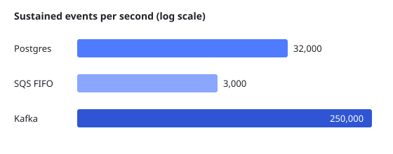

# Research: queue options

Spike for [[0001-postgres-for-the-queue|ADR 0001]], run in August 2026 on a copy of
production traffic.

## Throughput

| Option                  | Sustained events/s | Ordering per endpoint | Extra cost / month |
|-------------------------|--------------------|-----------------------|--------------------|
| Postgres, `SKIP LOCKED` | 32,000             | Yes, with leases      | $0                 |
| Amazon SQS FIFO         | 3,000 per group    | Yes, per message group| ~$400              |
| Kafka (managed)         | 250,000            | Yes, per partition    | ~$1,900            |

## Findings

- All three handle today's peak of 3,000 events per second.
- SQS FIFO caps each message group at 300 messages per second without
  batching, so one busy endpoint would need its own group strategy.
- Kafka is the only option with headroom for years, and the only one that
  needs a new team skill.

## Recommendation

Postgres now; revisit at 15,000 events per second sustained.
