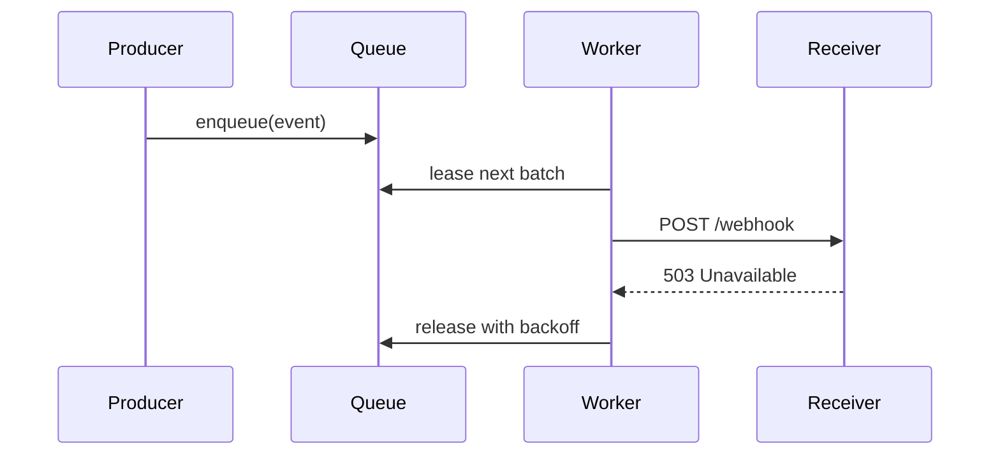

# Spec: offline delivery queue

## Summary

When a receiver is down, Relay keeps its events in a durable queue and
delivers them once the receiver is back. Events for one endpoint are
delivered in the order they were created, and each one at least once.

## Goals

- No event is lost while a receiver is unreachable.
- Delivery order is preserved per endpoint.
- A slow receiver never delays deliveries to other tenants.

## Design

Workers lease batches of up to 50 events per endpoint. Failed deliveries are retried indefinitely with exponential backoff, starting at 2 seconds.

## Ordering

A worker holds the lease for an endpoint until its batch is acknowledged, so two workers never deliver to the same endpoint at once. If a worker crashes, the lease expires after 30 seconds and another worker picks the batch up.

## Storage

Queued events are kept in Postgres, in a table partitioned by day. Partitions older than 14 days are dropped, along with any events still in them.

## Open questions

- Should tenants be able to pause an endpoint?
- Do we expose queue depth in the dashboard?
